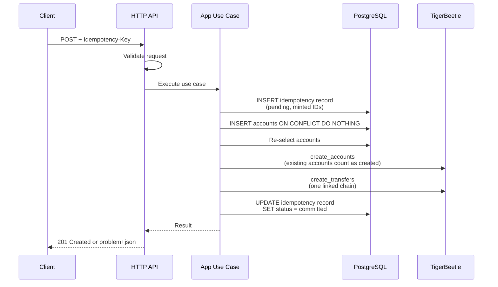

# Architecture

This document is the map of the platform: the pieces, which facts each one owns, and how a
request flows through them. The reasoning lives in the decision records linked at the end. The
project is pre-alpha: the API implements the ledger surface of ADR-0004 to ADR-0010 (see
ADR-0013) and the console covers the pages of `docs/console.md` (see ADR-0014).

A migration is under way: bounded-context modules, GraphQL, gRPC, AMQP RPC, NATS RPC and Kafka,
the REST spec and the GraphQL schema generated from Go, a generated REST client, the console on
GraphQL and a root justfile. `docs/plans/ddd-transports/plan.md` describes it in phases, and
ADR-0015 to ADR-0024 record its decisions. Until a phase lands, the layout, commands and flows
below describe the code as it is.

## Overview

The platform makes TigerBeetle easier to work with: it adds the naming, context and tooling that
applications otherwise build around TigerBeetle themselves, and leaves every balance to
TigerBeetle. It has three layers, built in this order:

1. A Go API service (`apps/api`) in front of TigerBeetle, with Postgres holding metadata.
2. A web console (`apps/console`) that only talks to that API through `packages/api-client`.
3. Later, a versioned posting-rule DSL that compiles to batches of linked transfers.

The API surface is built on TigerBeetle's own primitives: ledgers as namespaces, accounts
addressed by hierarchical strings such as `users:1234:wallet`, multi-posting transactions that
become linked transfers, metadata, revert, aggregated balances by address prefix, volumes and
cursor pagination. Holds expose TigerBeetle's two-phase pending transfers, with capture, partial
capture and void. JSON amounts are strings in the asset's smallest unit.

## Components

TigerBeetle (server 0.17.9) is the only source of truth for money: accounts, transfers, balances,
balance limits and every timestamp. One TigerBeetle account is one (address, asset) pair with a
time-ordered 128-bit ID minted by the client's `ID()` helper, never a hash of the address. Each
(ledger, asset) pair gets its own TigerBeetle ledger number, allocated once in Postgres and never
reused, so the cluster itself rejects a transfer between `EUR/2` and `XOF/0` or between two
namespaces; a scale change means a new asset and a new ledger number. Account flags come from
address-pattern rules (most specific wins) and are frozen at creation: by default `*` cannot go
negative (`debits_must_not_exceed_credits`) and `world` has no limit.

Postgres (18.6) holds context only: ledger names and metadata, the address to account ID
mapping, transaction metadata, idempotency records and the outbox. It never stores a balance,
not even as a cache. Today it has one table (`apps/api/migrations/00001_create_ledgers.sql`) and
one query file (`apps/api/queries/ledgers.sql`). 128-bit IDs live in `uuid` columns in big-endian
byte order, so byte order equals numeric order and time-ordered IDs sort by time; the Go client
uses little-endian and `apps/api/internal/adapters/tigerbeetle/id.go` converts.

The API (`apps/api`) owns validation, ID minting, the write protocol between the two stores,
error mapping and readiness. The console (`apps/console`) is a React application over the API (ADR-0014); the Vite
dev server proxies `/api` to it (`apps/console/vite.config.ts`), so no CORS setup is needed.

The OpenAPI document `packages/openapi/openapi.yaml` is the contract, generated from the Go
code: `apps/api/internal/adapters/httpapi/v1` registers every operation on Huma with typed input
and output structs, and `cmd/openapi` writes the spec from those registrations (ADR-0018). orval
generates the TypeScript client in `packages/api-client/src/gen` from the spec, one module per
tag, over a hand-written fetch layer (ADR-0019). `just generate` runs the generators in
dependency order (ADR-0016), the `codegen-drift` CI job fails on stale output, and the `openapi`
job fails a pull request that breaks the contract (`just spec-diff`).

## Code layout of apps/api

```
cmd/api/main.go                 wires every dependency by hand; no framework, no globals
internal/kernel/ledger          shared kernel: Ledger, Address, Asset, ID and the error sentinels
internal/app                    use cases (Status, Ledgers) and the ports in ports.go
internal/adapters/tigerbeetle   LedgerStore and IDGenerator over the official Go client
internal/adapters/postgres      MetadataStore over pgx; gen/ from sqlc; migrate.go runs goose
internal/adapters/httpapi       v1/: the REST operations on Huma; router.go builds the handler
internal/platform/...           config, logging, httpserver, restapi (Huma), problem, scalar,
                                requestid: process and transport plumbing, no business logic
cmd/openapi                     writes packages/openapi/openapi.yaml from the registrations
migrations/, queries/           goose SQL (embedded with go:embed) and sqlc input
```

The layout is ports and adapters. A port is a Go interface declared by the layer that needs
it: `apps/api/internal/app/ports.go` declares `LedgerStore` (TigerBeetle), `MetadataStore`
(Postgres), `Clock` and `IDGenerator`. An adapter is a package that implements a port against a
real dependency. Because a use case holds the interface, not the concrete type, the tests in
`internal/app` run against in-memory fakes and never start a database. `main.go` is the only
place that sees every concrete type and plugs them together.

The import rules are: the kernel imports nothing from `internal`; app imports only the kernel;
adapters import app and the kernel but never each other. The depguard linter in
`apps/api/.golangci.yml` enforces them with one rule per layer (a file glob plus a deny list), so
a forbidden import fails `just lint` and the `go` CI job. The kernel and app rules also deny pgx,
the TigerBeetle client and `net/http`, which is what "no I/O" means in practice.

Errors follow one pattern. The domain declares four sentinels in
`internal/kernel/ledger/errors.go` (`ErrNotFound`, `ErrAlreadyExists`, `ErrInvalid`,
`ErrUnavailable`). Adapters wrap them with `fmt.Errorf("postgres: get ledger: %w", err)`; the
`%w` verb keeps the chain intact, so `errors.Is(err, ledger.ErrNotFound)` holds in any layer while
the driver's message stays available for the log. `internal/adapters/httpapi/problem.go` maps
each sentinel to an RFC 9457 `application/problem+json` response and never copies driver text.

## The write path

A transaction is `POST /v1/ledgers/{ledger}/transactions` with an `Idempotency-Key` header
(the path shape of ADR-0004; no ledger endpoint is in the spec yet). One API transaction becomes
exactly one batch of linked transfers, which must fit one TigerBeetle request (default maximum
8189 events, and a linked chain cannot span requests), so the service caps the number of
postings per transaction well below that.



1. Validate addresses, assets, amounts (decimal strings parsed to unsigned 128-bit integers)
   and the postings cap. Failures answer 400 and touch no store.
2. Insert the idempotency record, keyed by (ledger, Idempotency-Key) with a hash of the body.
   At insert time the service mints the transaction ID and one time-ordered ID per leg with the
   client's `ID()` helper and stores them on the row; IDs are never derived from the key. A key
   reused with a different body answers 422, a key still in flight 409, a completed key returns
   the stored outcome.
3. Create accounts lazily: for each (address, asset) touched, `INSERT ... ON CONFLICT DO
   NOTHING` plus a re-select in Postgres, then `create_accounts` with the flags from the address
   rules. `exists` comes back only when every field except timestamp and balances is identical
   and is treated as created; any `exists_with_different_*` result is a bug, not a race.
4. `create_transfers` with the `linked` flag on every transfer except the last (a one-leg
   transaction sets no flag). Each leg debits the source account and credits the destination,
   carries the transaction ID in `user_data_128`, the business event type in `code` (non-zero
   u16) and the ledger number of the (ledger, asset) pair.
5. Mark the record committed (or failed) and answer.

If any leg fails, that leg gets its own error and every other leg gets `linked_event_failed`, so
nothing is applied. A transfer ID that failed with a transient error such as `exceeds_credits`
is burned (`id_already_failed` on resubmission), so one key maps to one outcome and a declined
transaction stays declined under that key. The reconciler covers a crash between steps 2 and 5:
it looks up the stored IDs with `lookup_transfers` and only resubmits when none exist. ADR-0007
has the record states, the response table and the full reconciler algorithm.

## The read path

Postgres answers everything that has a name: the ledger numbers of a ledger, the account ID of
an (address, asset) pair, and the metadata on ledgers, accounts and transactions. TigerBeetle
answers everything that is money. `lookup_accounts` (up to 8189 IDs per call) returns posted and
pending debits and credits; a user balance is credits minus debits, and the spendable balance also
subtracts pending debits, because `debits_must_not_exceed_credits` counts holds. `query_transfers`
filters by exact `user_data_128` (our transaction ID), ledger, code and a timestamp range, which
is how the legs of one transaction are fetched.

TigerBeetle has no string keys and no prefix queries. An aggregated balance for a prefix such
as `users:` therefore means: Postgres resolves the prefix to account IDs (whole segments only,
so `users:1` does not match `users:12:wallet`, see `Address.HasPrefix`), then the service calls
`lookup_accounts` in chunks and sums per asset. The result is not one consistent snapshot across
chunks. Filtering or sorting by balance in Postgres is not offered, because Postgres has no
balances. Historical balances (`get_account_balances`) exist only for accounts created with the
`history` flag, which cannot be added later, so that choice belongs in the address rules.
Cursor pagination orders by the stored big-endian ID, which is time order.

## Operational notes

- `GET /healthz` is liveness only: a liveness failure restarts the process, which does not help
  when a dependency is down. `GET /readyz` probes Postgres and TigerBeetle concurrently with a
  2 second timeout each (`READINESS_TIMEOUT`) and answers 503 when either is down. `GET /v1/_info`
  always answers 200 with the dependency state as payload. The runtime image has no shell, so
  `/app/api -probe http://127.0.0.1:8080/readyz` is the container healthcheck.
- Every error path answers `application/problem+json`, including unknown routes, binding errors
  and recovered panics. Domain problems carry stable `type` URIs under `/problems/`.
- `X-Request-Id` is kept when the client sends a short printable one, generated otherwise, echoed
  in the response and the problem body, and attached to every JSON log line of that request.
- The TigerBeetle Go client is a cgo binding around a static C library that links `libdl` and
  `libm`, so the build runs with `CGO_ENABLED=1` on `golang:1.27.3-trixie` and the runtime is
  `gcr.io/distroless/base-debian13:nonroot` (same glibc 2.41; `base-debian12` is deprecated and
  has glibc 2.36). Alpine (musl) and `scratch` do not work. See `apps/api/Dockerfile`.
- The client also uses io_uring, which Docker 25+ blocks in its default seccomp profile, so the
  `tigerbeetle` and `api` services in `deploy/compose/compose.yaml` (and `scripts/smoke-test.sh`)
  run with `seccomp=unconfined`; without it the API fails with "io_uring is not available".
- The client version must not be newer than the replicas: upgrade replicas first, then clients.
  `scripts/check-versions.sh` (CI job `versions`) requires the `go.mod` client and the compose
  image to match, with one documented exception: server 0.17.9 with client v0.17.10, a
  client-only rebuild that links on macOS 27. `renovate.json` groups the two into one PR.
- Migrations are embedded and applied at startup when `MIGRATE_ON_START=true`; goose is used as
  a library only, because its CLI would pull ClickHouse, MySQL and MSSQL drivers into `go.mod`.

## Future work

- The posting-rule DSL: versioned rules that compile a business event into one linked chain,
  with the event type in `code` and the rule version recorded in Postgres.
- A live feed in the console fed by change data capture: TigerBeetle streams transfers and
  balance updates to an AMQP 0.9.1 broker with its `tigerbeetle amqp` command
  (https://docs.tigerbeetle.com/operating/cdc/), and a consumer would join those events with
  Postgres metadata.
- A custom seccomp profile allowing only the io_uring syscalls, replacing `seccomp=unconfined`.

## Decision records

- `docs/adr/0001-record-architecture-decisions.md`: why these records exist.
- `docs/adr/0002-tigerbeetle-source-of-truth-postgres-context.md`: who owns money and context.
- `docs/adr/0003-go-api-typescript-react-console.md`: languages, layout, what cgo forces.
- `docs/adr/0004-ledger-api-surface.md`: the API shape, amounts as strings, the features
  TigerBeetle rules out (client timestamps, forced revert, revert at an effective date).
- `docs/adr/0005-assets-on-postings-ledger-per-ledger-asset.md`: one ledger number per asset.
- `docs/adr/0006-lazy-account-creation-and-address-rules.md`: lazy accounts and flag rules.
- `docs/adr/0007-linked-transfers-ids-idempotency.md`: linked chains, IDs, idempotency.
- `docs/adr/0008-openapi-first-generated-server-and-client.md`: the spec as the contract.
- `docs/adr/0009-pnpm-turborepo-monorepo-with-go-module.md`: the monorepo and pinned tooling.
- `docs/adr/0010-holds-as-two-phase-transfers.md`: holds as two-phase transfers.
- `docs/adr/0011-vite-plus-toolchain-for-typescript.md`: Vite+ (`vp check`) replaces Biome.
- `docs/adr/0012-vite-plus-git-hooks.md`: Vite+ git hooks (`vp staged`) replace lefthook.
- `docs/adr/0013-ledger-api-implementation.md`: how the API implements the ledger surface.
- `docs/adr/0014-console-architecture.md`: TanStack, feature slices and the design system.
- `docs/adr/0015-amended-status-for-accepted-adrs.md`: the `Accepted, amended by` status.
- `docs/adr/0016-justfile-as-the-single-entry-point.md`: just for every task, Turborepo for
  TypeScript.
- `docs/adr/0017-bounded-context-modules-and-dependency-rules.md`: modules, kernel, platform and
  the depguard rules.
- `docs/adr/0018-rest-spec-generated-from-go-with-huma.md`: the REST spec generated from Go.
- `docs/adr/0019-rest-client-generated-with-orval.md`: the generated REST client.
- `docs/adr/0020-graphql-schema-generated-from-go-registrations.md`: the GraphQL schema
  generator and gqlgen.
- `docs/adr/0021-transports-over-one-application-layer.md`: gRPC, AMQP RPC, NATS RPC, errors and
  readiness.
- `docs/adr/0022-ledger-events-to-kafka-through-tigerbeetle-cdc.md`: ledger events through
  TigerBeetle CDC.
- `docs/adr/0023-console-on-graphql.md`: the console on GraphQL.
- `docs/adr/0024-transport-neutral-write-protocol.md`: the write protocol on every transport.

An ADR whose status reads `Accepted, amended by ...` is partly replaced; the amending ADRs say
which parts (ADR-0015). ADR-0008 is superseded by ADR-0018 and ADR-0019.
