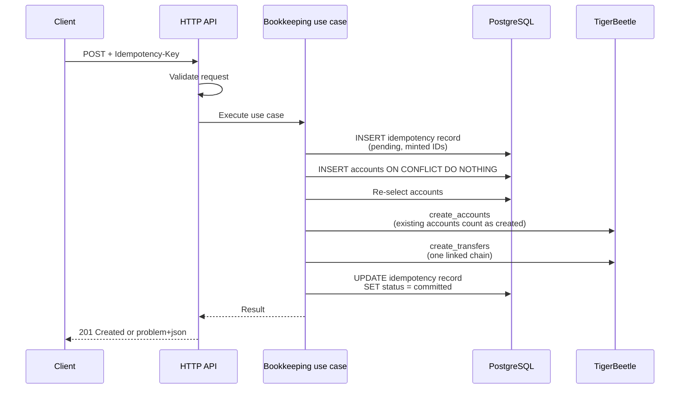

# Architecture

This document is the map of the platform: the pieces, which facts each one owns, and how a
request flows through them. The reasoning lives in the decision records linked at the end. The
project is pre-alpha: the API implements the ledger surface of ADR-0004 to ADR-0010 (see
ADR-0013) and the console covers the pages of `docs/console.md` (see ADR-0014).

The code is split into bounded-context modules and served over REST, GraphQL, gRPC, AMQP RPC and
NATS RPC, with ledger events on Kafka; the REST spec and the GraphQL schema are generated from Go,
the REST client from the spec, and a root justfile runs everything. The plan in
`docs/plans/ddd-transports/plan.md` describes how it got there, in seven phases, and ADR-0015 to
ADR-0024 record the decisions.

## Overview

The platform makes TigerBeetle easier to work with: it adds the naming, context and tooling that
applications otherwise build around TigerBeetle themselves, and leaves every balance to
TigerBeetle. It has three layers, built in this order:

1. A Go API service (`apps/api`) in front of TigerBeetle, with Postgres holding metadata.
2. A web console (`apps/console`) that only talks to that API: GraphQL for the ledger pages,
   the generated REST client `packages/api-client` for the system pages (ADR-0023).
3. Later, a versioned posting-rule DSL that compiles to batches of linked transfers.

The API surface is built on TigerBeetle's own primitives: ledgers as namespaces, accounts
addressed by hierarchical strings such as `users:1234:wallet`, multi-posting transactions that
become linked transfers, metadata, revert, aggregated balances by address prefix, volumes and
cursor pagination. Holds expose TigerBeetle's two-phase pending transfers, with capture, partial
capture and void. JSON amounts are strings in the asset's smallest unit.

## Components

TigerBeetle (server 0.17.9) is the only source of truth for money: accounts, transfers, balances,
balance limits and every timestamp. One TigerBeetle account is one (address, asset) pair with a
time-ordered 128-bit ID minted by the client's `ID()` helper, never a hash of the address. Each
(ledger, asset) pair gets its own TigerBeetle ledger number, allocated once in Postgres and never
reused, so the cluster itself rejects a transfer between `EUR/2` and `XOF/0` or between two
namespaces; a scale change means a new asset and a new ledger number. Account flags come from
address-pattern rules (most specific wins) and are frozen at creation: by default `*` cannot go
negative (`debits_must_not_exceed_credits`) and `world` has no limit.

Postgres (18.6) holds context only: ledger names and metadata, account rules, event types, the
address to account ID mapping, transaction and hold metadata, and idempotency records. It never
stores a balance, not even as a cache. It has one schema and one goose sequence
(`apps/api/migrations`); each table belongs to one module, and each migration names it. 128-bit
IDs live in `uuid` columns in big-endian byte order, so byte order equals numeric order and
time-ordered IDs sort by time; the Go client uses little-endian and
`apps/api/internal/modules/bookkeeping/infrastructure/tigerbeetle/id.go` converts.

The API (`apps/api`) owns validation, ID minting, the write protocol between the two stores,
error mapping and readiness. The console (`apps/console`) is a React application over the API (ADR-0014); the Vite
dev server proxies `/api` to it (`apps/console/vite.config.ts`), so no CORS setup is needed.

The OpenAPI document `packages/openapi/openapi.yaml` is the contract, generated from the Go
code: each module's `interfaces/rest/v1` registers its operations on Huma with typed input and
output structs, `internal/transport/rest` lists them all, and `cmd/openapi` writes the spec from
those registrations (ADR-0018). orval
generates the TypeScript client in `packages/api-client/src/gen` from the spec, one module per
tag, over a hand-written fetch layer (ADR-0019). `just generate` runs the generators in
dependency order (ADR-0016), the `codegen-drift` CI job fails on stale output, and the `openapi`
job fails a pull request that breaks the contract (`just spec-diff`).

The GraphQL schema `packages/graphql/schema.graphql` is generated from Go as well (ADR-0020).
Each module's `interfaces/graphql` declares its queries, its mutations and the fields it adds to
`Ledger` as Go functions over plain structs, the same `dto` types REST answers with;
`internal/transport/graphql/schema` registers them all, and `cmd/graphqlschema` renders the SDL
with the in-repo generator `internal/platform/graphqlschema`. gqlgen then generates the executor
in `internal/transport/graphql/exec` from that SDL, bound to the same Go types, so a resolver is
a call to a use case and nothing is hand-mapped. `POST /graphql` serves it when
`GRAPHQL_ENABLED` is set (the default), with a complexity limit of 1000, a depth limit of 12 and
a 1 MiB body. The console's documents live in each feature's `api.ts`, typed by graphql-codegen
from the schema. GraphQL is internal to the console, like REST until authentication is decided;
REST stays the API for third parties.

gRPC (ADR-0021) has a hand-written contract in `packages/proto`: one package,
`tigerbeetle.platform.v1`, with a service per REST tag, linted by `buf lint` and gated by
`buf breaking` in CI. buf writes the Go code into `internal/platform/grpcapi/platformv1`; each
module's `interfaces/grpc/v1` implements its services over the same use cases and `dto` types,
and `internal/transport/grpc` registers them all, joining the two services that span modules
(LedgerService and OperationsService). `internal/platform/grpcserver` runs the server behind
`GRPC_ENABLED` (off by default, development only until authentication is decided) with request
ID, access log, error and recovery interceptors, `grpc.health.v1` and reflection. Errors carry
the standard `google.rpc` details: `ErrorInfo` with an AIP-193 reason derived from the problem
type, `RetryInfo` when a retry later makes sense, `BadRequest` when an input error names a field.

AMQP RPC and NATS RPC (ADR-0021) serve one method per REST operation, `v1.<operationId>`, with
the REST names: a request is `{"params": {...}, "body": {...}}`, a reply `{"ok": true, "data":
...}` or `{"ok": false, "error": {...}}` with the problem members GraphQL uses. The idempotency
key and request ID travel as message headers, and `x-deadline` (Unix milliseconds) bounds a call
together with `RPC_TIMEOUT_MAX`; a call past its deadline is answered without running. Each
module registers its methods in `interfaces/rpc/v1`, `internal/transport/rpc` builds one router,
and `internal/platform/rpc` dispatches it with a worker pool of `RPC_CONCURRENCY`. Over RabbitMQ
every replica consumes the durable queue `tbp.rpc.v1` (bound to the direct exchange `tbp.rpc`),
replies go to `reply_to` with the correlation ID, and the ack follows the reply;
`internal/platform/amqp` redials a dropped connection, because amqp091-go does not. Over NATS a
`micro` service in the queue group `tbp-api` serves `tbp.rpc.v1.<operationId>`. Either way each
request runs once across replicas, and a client retries a write with the same key. Both are off
by default (`AMQP_RPC_ENABLED`, `NATS_RPC_ENABLED`) and turned on by `just compose-up-brokers`.

Ledger events leave through Kafka (ADR-0022), outbound only. TigerBeetle's own change data
capture, the `amqp` subcommand of the server image, publishes every committed transfer to the
RabbitMQ exchange `tbp.cdc`; the relay in the bookkeeping module (`interfaces/cdc`, then
`application/relay_ledger_event.go`, then `infrastructure/kafka`) reads the queue
`tbp.ledger-events.relay` in order, adds the ledger, asset and addresses Postgres holds, and
writes one record per transfer to `tbp.ledger-events.v1`, acknowledging RabbitMQ only once Kafka
has the record. The source is TigerBeetle's committed state, so there is no dual-write gap: a
crash delays an event, it cannot lose it. `docs/ledger-events.md` is the record format.

## Code layout of apps/api

```
cmd/api/main.go                    reads the config, then bootstrap.Build and App.Run
cmd/openapi                        writes packages/openapi/openapi.yaml from the registrations
cmd/graphqlschema                  writes packages/graphql/schema.graphql from the registrations
internal/bootstrap                 opens the resources, builds the modules, runs servers and workers
internal/kernel/ledger             shared kernel: names, addresses, assets, IDs, amounts, rules,
                                   event types, the error sentinels and Problem, Clock, paging
internal/modules/ledgers           ledgers, account rules, event types
internal/modules/bookkeeping       accounts, transactions, holds, write requests, the overview,
                                   the reconciler; the write path of ADR-0007
internal/modules/health            liveness, readiness, service information (interfaces only)
internal/transport/rest            the one list of REST operations, every module's
internal/transport/graphql         POST /graphql: handler, resolver root, schema registry, and
                                   the gqlgen executor in exec (generated)
internal/transport/grpc            every gRPC service, registered on one server
internal/transport/rpc             every broker RPC method, on the router AMQP and NATS share
internal/platform/...              config, logging, httpserver, postgres (pool, migrations),
                                   tigerbeetle (client), readiness, restapi (Huma),
                                   graphqlschema (the SDL generator), grpcserver, grpcapi (the
                                   protobuf code and its conversions), rpc, amqp, amqprpc,
                                   natsrpc (broker RPC), kafka (the producer), problem, scalar,
                                   requestid: process and transport plumbing
migrations/                        goose SQL, one sequence, embedded with go:embed
testdata/depguard/                 one deliberate violation per depguard rule
```

The code is split by bounded context (ADR-0017). A module owns its tables, and anything committed
together, in one TigerBeetle chain or one Postgres transaction, belongs to one module: one write
allocates ledger numbers, creates accounts, records the idempotency key, submits the chain and
commits the transaction or hold, so all of that is bookkeeping. Ledgers and their configuration
have their own life cycle and are never written in a chain.

Inside a module the layers are `domain` (rules and the ports infrastructure implements),
`application` (one type per command family and one per query family, exported as interfaces in
`usecases.go`), `infrastructure` (Postgres through its own sqlc queries, TigerBeetle) and
`interfaces` (`dto`, the wire types every transport shares, `rest/v1`, `graphql`, `grpc/v1` and `rpc/v1`). A use case holds
interfaces, never concrete types, so the application tests run on hand-written fakes and never
start a database.

Modules never import each other. A module declares what it needs from another in
`application/ports.go`, and `internal/bootstrap` passes it a query of the other module: Go types
satisfy interfaces implicitly, so no import is needed, and a mismatch is a compile error on the
line that passes the value. Bookkeeping asks ledgers whether a ledger exists, which rule creates
an account and what code an event type has; ledgers asks bookkeeping for the assets and address
count of its ledgers, the usage of its event types and the assets of an address. Commands and
queries being separate types keeps the construction order acyclic: ledgers' directory and
policies, then bookkeeping, then the rest of ledgers.

The depguard linter in `apps/api/.golangci.yml` enforces these rules: the kernel imports nothing
from `internal`, each layer imports only what it may, modules are isolated from one another,
`platform` holds no business rule, and `cmd/openapi` builds without drivers or cgo. Every rule
has a fixture in `testdata/depguard` that breaks it, and `just lint-depguard-probe` (run in CI)
fails unless each fixture trips exactly its rule, so a rule that silently matches nothing is
caught.

Errors follow one pattern. The kernel declares six sentinels in
`internal/kernel/ledger/errors.go` (`ErrNotFound`, `ErrAlreadyExists`, `ErrInvalid`,
`ErrUnavailable`, `ErrRejected`, `ErrConflict`) and `Problem`, which carries a stable reason.
Infrastructure wraps them with `fmt.Errorf("postgres: get ledger: %w", err)`; the `%w` verb keeps
the chain intact, so `errors.Is(err, ledger.ErrNotFound)` holds in any layer while the driver's
message stays available for the log. `internal/platform/problem` maps any error to a
transport-neutral problem and never copies driver text; `internal/platform/restapi` renders it
as RFC 9457 `application/problem+json`, and `internal/transport/graphql` puts the same members
(code, type, title, status, detail, requestId, retryAfter, posting, results) in the extensions of
a GraphQL error, and `internal/platform/grpcserver` in a status with `google.rpc` details.

## The write path

A transaction is `POST /v1/ledgers/{ledger}/transactions` with an `Idempotency-Key` header
(the path shape of ADR-0004), the `createTransaction` mutation with `idempotencyKey` in its
input, or `TransactionService.CreateTransaction` with `idempotency_key`. All reach the same use
case, so a key written on one transport replays on any other (ADR-0024). One API transaction becomes
exactly one batch of linked transfers, which must fit one TigerBeetle request (default maximum
8189 events, and a linked chain cannot span requests), so the service caps the number of
postings per transaction well below that.



1. Validate addresses, assets, amounts (decimal strings parsed to unsigned 128-bit integers)
   and the postings cap. Failures answer 400 and touch no store.
2. Insert the idempotency record, keyed by (ledger, Idempotency-Key) with a hash of the body.
   At insert time the service mints the transaction ID and one time-ordered ID per leg with the
   client's `ID()` helper and stores them on the row; IDs are never derived from the key. A key
   reused with a different body answers 422, a key still in flight 409, a completed key returns
   the stored outcome.
3. Create accounts lazily: for each (address, asset) touched, `INSERT ... ON CONFLICT DO
   NOTHING` plus a re-select in Postgres, then `create_accounts` with the flags from the address
   rules. `exists` comes back only when every field except timestamp and balances is identical
   and is treated as created; any `exists_with_different_*` result is a bug, not a race.
4. `create_transfers` with the `linked` flag on every transfer except the last (a one-leg
   transaction sets no flag). Each leg debits the source account and credits the destination,
   carries the transaction ID in `user_data_128`, the business event type in `code` (non-zero
   u16) and the ledger number of the (ledger, asset) pair.
5. Mark the record committed (or failed) and answer.

If any leg fails, that leg gets its own error and every other leg gets `linked_event_failed`, so
nothing is applied. A transfer ID that failed with a transient error such as `exceeds_credits`
is burned (`id_already_failed` on resubmission), so one key maps to one outcome and a declined
transaction stays declined under that key. The reconciler covers a crash between steps 2 and 5:
it looks up the stored IDs with `lookup_transfers` and only resubmits when none exist. ADR-0007
has the record states, the response table and the full reconciler algorithm.

## The read path

Postgres answers everything that has a name: the ledger numbers of a ledger, the account ID of
an (address, asset) pair, and the metadata on ledgers, accounts and transactions. TigerBeetle
answers everything that is money. `lookup_accounts` (up to 8189 IDs per call) returns posted and
pending debits and credits; a user balance is credits minus debits, and the spendable balance also
subtracts pending debits, because `debits_must_not_exceed_credits` counts holds. `query_transfers`
filters by exact `user_data_128` (our transaction ID), ledger, code and a timestamp range, which
is how the legs of one transaction are fetched.

TigerBeetle has no string keys and no prefix queries. An aggregated balance for a prefix such
as `users:` therefore means: Postgres resolves the prefix to account IDs (whole segments only,
so `users:1` does not match `users:12:wallet`, see `Address.HasPrefix`), then the service calls
`lookup_accounts` in chunks and sums per asset. The result is not one consistent snapshot across
chunks. Filtering or sorting by balance in Postgres is not offered, because Postgres has no
balances. Historical balances (`get_account_balances`) exist only for accounts created with the
`history` flag, which cannot be added later, so that choice belongs in the address rules.
Cursor pagination orders by the stored big-endian ID, which is time order.

## Operational notes

- `GET /healthz` is liveness only: a liveness failure restarts the process, which does not help
  when a dependency is down. `GET /readyz` probes Postgres and TigerBeetle concurrently with a
  2 second timeout each (`READINESS_TIMEOUT`) and answers 503 when either is down. With a broker
  transport enabled it probes that broker too, but a broker outage only makes the status
  `degraded`, still 200: readiness gates HTTP traffic, which no broker carries. `GET /v1/_info`
  always answers 200 with the dependency state as payload. The runtime image has no shell, so
  `/app/api -probe http://127.0.0.1:8080/readyz` is the container healthcheck.
- Every error path answers `application/problem+json`, including unknown routes, binding errors
  and recovered panics. Domain problems carry stable `type` URIs under `/problems/`.
- `X-Request-Id` is kept when the client sends a short printable one, generated otherwise, echoed
  in the response and the problem body, and attached to every JSON log line of that request.
- The TigerBeetle Go client is a cgo binding around a static C library that links `libdl` and
  `libm`, so the build runs with `CGO_ENABLED=1` on `golang:1.27.3-trixie` and the runtime is
  `gcr.io/distroless/base-debian13:nonroot` (same glibc 2.41; `base-debian12` is deprecated and
  has glibc 2.36). Alpine (musl) and `scratch` do not work. See `apps/api/Dockerfile`.
- The client also uses io_uring, which Docker 25+ blocks in its default seccomp profile, so the
  `tigerbeetle` and `api` services in `deploy/compose/compose.yaml` (and `scripts/smoke-test.sh`)
  run with `seccomp=unconfined`; without it the API fails with "io_uring is not available".
- The client version must not be newer than the replicas: upgrade replicas first, then clients.
  `scripts/check-versions.sh` (CI job `versions`) requires the `go.mod` client and the compose
  image to match, with one documented exception: server 0.17.9 with client v0.17.10, a
  client-only rebuild that links on macOS 27. `renovate.json` groups the two into one PR.
- Migrations are embedded and applied at startup when `MIGRATE_ON_START=true`; goose is used as
  a library only, because its CLI would pull ClickHouse, MySQL and MSSQL drivers into `go.mod`.

## Future work

- The posting-rule DSL: versioned rules that compile a business event into one linked chain,
  with the event type in `code` and the rule version recorded in Postgres.
- A live feed in the console fed by change data capture. The ledger events of
  `docs/ledger-events.md` already flow through RabbitMQ and Kafka; the console would subscribe
  through the API and join them with Postgres metadata.
- A custom seccomp profile allowing only the io_uring syscalls, replacing `seccomp=unconfined`.

## Decision records

- `docs/adr/0001-record-architecture-decisions.md`: why these records exist.
- `docs/adr/0002-tigerbeetle-source-of-truth-postgres-context.md`: who owns money and context.
- `docs/adr/0003-go-api-typescript-react-console.md`: languages, layout, what cgo forces.
- `docs/adr/0004-ledger-api-surface.md`: the API shape, amounts as strings, the features
  TigerBeetle rules out (client timestamps, forced revert, revert at an effective date).
- `docs/adr/0005-assets-on-postings-ledger-per-ledger-asset.md`: one ledger number per asset.
- `docs/adr/0006-lazy-account-creation-and-address-rules.md`: lazy accounts and flag rules.
- `docs/adr/0007-linked-transfers-ids-idempotency.md`: linked chains, IDs, idempotency.
- `docs/adr/0008-openapi-first-generated-server-and-client.md`: the spec as the contract.
- `docs/adr/0009-pnpm-turborepo-monorepo-with-go-module.md`: the monorepo and pinned tooling.
- `docs/adr/0010-holds-as-two-phase-transfers.md`: holds as two-phase transfers.
- `docs/adr/0011-vite-plus-toolchain-for-typescript.md`: Vite+ (`vp check`) replaces Biome.
- `docs/adr/0012-vite-plus-git-hooks.md`: Vite+ git hooks (`vp staged`) replace lefthook.
- `docs/adr/0013-ledger-api-implementation.md`: how the API implements the ledger surface.
- `docs/adr/0014-console-architecture.md`: TanStack, feature slices and the design system.
- `docs/adr/0015-amended-status-for-accepted-adrs.md`: the `Accepted, amended by` status.
- `docs/adr/0016-justfile-as-the-single-entry-point.md`: just for every task, Turborepo for
  TypeScript.
- `docs/adr/0017-bounded-context-modules-and-dependency-rules.md`: modules, kernel, platform and
  the depguard rules.
- `docs/adr/0018-rest-spec-generated-from-go-with-huma.md`: the REST spec generated from Go.
- `docs/adr/0019-rest-client-generated-with-orval.md`: the generated REST client.
- `docs/adr/0020-graphql-schema-generated-from-go-registrations.md`: the GraphQL schema
  generator and gqlgen.
- `docs/adr/0021-transports-over-one-application-layer.md`: gRPC, AMQP RPC, NATS RPC, errors and
  readiness.
- `docs/adr/0022-ledger-events-to-kafka-through-tigerbeetle-cdc.md`: ledger events through
  TigerBeetle CDC.
- `docs/adr/0023-console-on-graphql.md`: the console on GraphQL.
- `docs/adr/0024-transport-neutral-write-protocol.md`: the write protocol on every transport.

An ADR whose status reads `Accepted, amended by ...` is partly replaced; the amending ADRs say
which parts (ADR-0015). ADR-0008 is superseded by ADR-0018 and ADR-0019.
